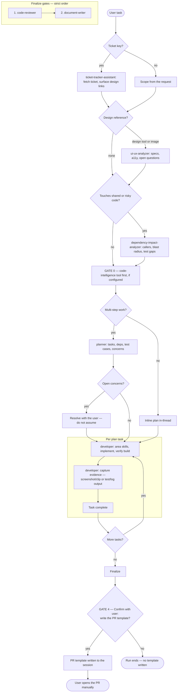

# vibe-flow — the end-to-end workflow

**vibe-flow** is this project's end-to-end workflow: how a task moves from request to a
ready-to-open PR, and which specialist owns each step. The roles themselves are described in
[HARNESS.md](HARNESS.md); this file is the **order they run in, the gates between them, and how to
start one**.

vibe-flow uses this project's code-intelligence tool (if one is configured) for code
intelligence, never creates or pushes a PR itself, and keeps per-run state in
`.claude/working-sessions/`.

---

## How to invoke it

### Via the `vibe-flow` skill (or a slash command wired to it)

```
/vibe-flow #12
/vibe-flow add a "next preset" hotkey to the visualizer source
```

It loads this document, bootstraps the run and then acts as orchestrator. With no argument it asks
what the task is rather than guessing. A bare task (as above) is shorthand for `full <task>` —
runs the whole flow end to end, stopping only at the gates below.

### Splitting a run into single steps

The same run can be driven one step at a time instead of end to end — useful for checking in
between phases, or handing a session to someone else mid-flow. Each single-step form other than
`plan` requires an **existing session path** and errors out (naming what's missing) rather than
inventing the missing upstream artifact:

```
/vibe-flow plan ISSUE-123                                                  # new session, stop after plan + Gate 1
/vibe-flow develop .claude/working-sessions/20260826143022-pause-membership   # stop after develop + Gate 1.5
/vibe-flow review  .claude/working-sessions/20260826143022-pause-membership   # stop after code-reviewer (Gate 2)
/vibe-flow document .claude/working-sessions/20260826143022-pause-membership  # stop after document-writer (Gate 3)
/vibe-flow pr .claude/working-sessions/20260826143022-pause-membership        # Gate 4 confirm + PR template
/vibe-flow full ISSUE-123                                                     # end to end, equivalent to the bare form
```

| Form | Requires | Runs through | Stops before |
|---|---|---|---|
| `plan <task>` | nothing (creates the session) | intake → design → impact → Gate 0 → planner → Gate 1 | `develop` |
| `develop <session>` | `plan/output-plan-*.md` | the develop loop (all plan tasks + evidence) | `code-reviewer` |
| `review <session>` | `develop/evidence/` + task handoffs | `code-reviewer` (Gate 2) | `document-writer` |
| `document <session>` | `review/output-review-findings.md` | `document-writer` (Gate 3) | Gate 4 |
| `pr <session>` | `docs/output-doc-sync-report.md` | Gate 4 confirm + PR template | — (run ends) |
| `full <task or resume>` | nothing new | everything, end to end | — (stops only at gates) |

Each step still writes its own gate and artifacts exactly as the full run would — running them
individually changes *when the orchestrator stops*, not what any step does or which gates apply.

Two other forms:

```
/vibe-flow resume .claude/working-sessions/20260826143022-pause-membership
/vibe-flow step dependency-impact-analyzer PaymentService.charge
```

`resume` (equivalently `full resume <path>`) picks up at the first step with no output and keeps
going end to end. `step` runs one specialist with no session directory and no gates — the cheap
path when you want a single opinion, not a whole run.

### Without the command

Naming the flow in an ordinary message works identically — "run vibe-flow on ISSUE-123",
"use vibe-flow for this". The command is a shortcut, not a requirement.

### What the orchestrator does, either way

1. Creates the run directory and log:

   ```bash
   RUN=".claude/working-sessions/$(date +%Y%m%d%H%M%S)-<slug>"
   mkdir -p "$RUN"/{inputs,intake,analyze,plan,develop/evidence,review,docs}
   printf '%s  orchestrator  session start: %s\n' "$(date -u +%FT%TZ)" "<task>" >> "$RUN/session.log"
   ```

2. Writes `inputs/requirements.md` — the request restated as scope, in the user's own words where
   possible.
3. Walks the flowchart below, delegating each step.
4. Stops at every gate that needs the user (see **The gates**).
5. Asks the user to confirm before writing the PR template (**Gate 4**) — on yes, finishes by
   writing `output-pull-request.md` and handing over the path; on no, ends the run there with no
   template written.

### Delegating one step

Each specialist gets a **delegation packet** — see the exact shape in
[HARNESS.md](HARNESS.md#the-delegation-contract). The agent handles the rest — its own execution
order, artifacts and output structure are baked into its own file under `harness/`.

### Run one specialist without the whole flow

Perfectly normal, and cheaper — `/vibe-flow step <role> <task>`, or just ask:

```
have the dependency-impact-analyzer look at PaymentService.charge
run the ui-ux-analyzer on this design link
code-review what I just changed
```

Give it a session directory if you want durable artifacts; otherwise it reports in-thread.

### Resume, inspect or redo a run

```
/vibe-flow resume .claude/working-sessions/20260826143022-pause-membership
```

The artifacts are the state — the orchestrator reads `session.log` plus whichever `output-*.md`
files exist, and picks up at the first step that has no output. To redo a step, delete its output
file and say which step.

### When not to use it

A one-file fix, a rename, a question about the codebase. vibe-flow earns its overhead when
the work is multi-step, touches shared code, carries a ticket or a design, or will be reviewed by
someone else.

## Layers

| Layer | Location | Purpose |
|-------|----------|---------|
| Master rules | root `CLAUDE.md` | *What* to do — rules, gates, conventions |
| Project knowledge | `docs/`, `.claude/COMMON-ISSUES.md`, `.claude/DICTIONARY.md`, `.claude/HOW-X-WORKS.md`, `.claude/MEMORY.md` | *How* the code is built — agents read, never guess |
| Harness bodies | `.claude/harness/` | Specialist agent instructions (canonical copy) |
| Discovery | `.claude/agents/`, `.claude/skills/` | Copies/links so your AI tool finds the harness |
| Session state | `.claude/working-sessions/<run>/` | Per-run input/output artifacts and the log |
| Code intelligence | CodeGraph (`codegraph_explore` MCP tool, `codegraph explore` in the shell), if `.codegraph/` exists | Structural queries instead of grep sweeps |
| Ticket + design intake | GitHub Issues on `lee5783/synesthesia-vibe-obs` through `gh`; no design-tool integration | Tickets, design specs |
| Enforcement | Gate order below + the PR template | Review → docs → confirm → PR, in that order |

---

## End to end



**vibe-flow, in one line:**

```
intake → [ux] → [impact] → GATE 0 code intelligence → plan → develop+evidence(loop) → review → docs → GATE 4 confirm → PR template
```

---

## The gates

Gates exist because a fully autonomous run will, left unchecked, do the easy wrong thing at each
of these points: skip straight to source instead of using the faster/more-accurate tool, silently
assume an answer to a genuinely open question, ship a change nobody watched work, write docs
against unverified behavior, or open a PR nobody asked for yet. Each gate below names the specific
failure it exists to block.

**Gate 0 — code intelligence first, if configured.** Before any agent reads source in bulk, query
this project's code-intelligence tool if one exists (see root `CLAUDE.md`). It is pre-built
structure: one query returns verbatim source, callers and blast radius, cheaper and more reliable
than a grep sweep. Falling straight to grep-and-read when a better tool is available is a rule
violation, not a shortcut (root `CLAUDE.md`, Rule 2). **If the tool is configured but will not
connect, stop and tell the user** — never substitute a silent grep sweep. If no such tool is
configured, this gate is a no-op — proceed straight to research via `docs/` and source.

**Gate 1 — Concerns before code.** `output-plan-concerns.md` is not decoration. Material gaps
(unstated behavior, missing copy, undefined failure UX) get resolved with the user in-thread
before development starts. "No open concerns" on a thin spec is a failure of the gate.

**Gate 1.5 — Evidence before review.** A task is not complete until the `developer` has captured
proof it works in context: a screenshot or short clip for UI/behavior changes, a trimmed
log/test-output excerpt otherwise. A green build shows the code compiles, not that the feature
does anything. `code-reviewer` reviews the evidence alongside the diff, so a task arriving without
it goes back to the developer rather than forward.

**Visual evidence (image or video) is mandatory for any UI-related task** on a project with a UI
surface — not optional, not a "clearly stated reason" away. Before claiming a capture is
impossible, the developer must actually attempt it end-to-end (build/run, whatever "boot the app
and interact with it" means for this project's stack). Only a genuine, freshly-confirmed blocker
(verified this session, not quoted from an older handoff) excuses a still/clip — an "this can't be
run" claim from a stale handoff must be re-verified, not repeated on faith.

**Gate 2 — Review before docs.** `document-writer` runs on **verified** behavior. Docs written
against unreviewed code document a guess. Its target is `docs/` — a repo's own `./docs/`
and the root `README.md` are written only when the user explicitly asked for them that turn.

**Gate 3 — Docs before PR.** The PR template's docs checklist is filled from
`output-doc-sync-report.md`, so the docs pass must already have happened.

**Gate 4 — Confirm before the PR template.** After docs, the orchestrator stops and asks the user
whether to write `output-pull-request.md` — this is a real question, not a rhetorical pause before
proceeding anyway. If the user agrees, write the template as described below. If they decline (or
ask to stop, or don't want a PR right now), end the run there: no `output-pull-request.md`, no
further steps. Everything already written under the session directory (plan, handoffs, evidence,
review, docs) stays as-is either way — only the PR template is gated.

The order is **review → docs → confirm → PR**. Do not reorder, do not run them concurrently.

---

## Specialist routing

| Task signal | Agent |
|-------------|-------|
| Ticket key in the request | `ticket-tracker-assistant` *(if that role is in use)* |
| Design URL, screenshot, "implement this design" | `ui-ux-analyzer` *(if that role is in use)* |
| "What breaks if…", shared type, public API, risky refactor | `dependency-impact-analyzer` |
| Multi-step feature, needs decomposition | `planner` |
| Implement a plan task, fix a bug, refactor | `developer` (+ area-matched project skills) |
| Capture proof a change works | `developer` → *Evidence* |
| Work is complete, needs a review pass | `code-reviewer` |
| Behavior shipped and verified, docs stale | `document-writer` |
| PR body needed | *(orchestrator)* |

Small, obvious, single-file work does not need the harness. Route into it when the task is
multi-step, touches shared code, carries a ticket or a design, or will be reviewed by someone
else.

---

## Session working directory

Everything a run produces lives under **`.claude/working-sessions/`** — see the full layout in
[HARNESS.md](HARNESS.md#session-artifacts).

**Filename rule:** inside a step directory every markdown file starts with `input-` or `output-`.
Everything else follows root `CLAUDE.md`: kebab-case, letters/digits/hyphens only,
`yyyyMMddHHmmss` for the run timestamp.

**This project commits session artifacts, except bulk evidence** — `.gitignore` excludes
everything under `.claude/working-sessions/*/develop/evidence/` except its `*.md` reports and `*.py`
scripts. A run's requirements, plan, concerns, handoffs, review findings and evidence reports
travel with `git clone` and land in PR history, so the next session (on any machine) reads them
instead of re-deriving. Captured frames, dumps and logs stay local to the machine that produced
them, so handoffs quote the results they rely on. This is the template default; changing it (e.g. to
gitignore whole sessions) is the user's call, not something an agent should flip mid-run.

---

## The PR step — template only

**No agent creates, pushes or merges a PR.** Once review and docs are done, the orchestrator asks
the user to confirm before writing the template (**Gate 4**) — e.g. "Ready to write the PR
template for this run?". Only on a yes does the final gate write a filled `output-pull-request.md`
into the session root, from [`templates/pull-request.md`](templates/pull-request.md); on a no, the
run ends there and no template is written. The user opens the PR manually and pastes it.

The orchestrator fills it from artifacts that already exist — do not re-derive:

| Template section | Source |
|---|---|
| Summary, scope | `plan/output-plan-summary.md` |
| Changes, files | the `develop/output-TASK-*.md` handoffs |
| Verification | the build/test commands recorded in those handoffs |
| Evidence | `develop/evidence/` — the captures the handoffs point to |
| Manual QA | `plan/output-plan-test-cases.md` |
| Review notes | `review/output-review-findings.md` |
| Docs | `docs/output-doc-sync-report.md` |
| Risks, follow-ups | *Known limitations* across the handoffs, plus unresolved concerns |

Every checkbox must reflect something that actually happened. An unchecked box with a one-line
reason is fine; a checked box that did not happen makes the whole template worthless.

If you want your hosting platform to prefill this for every PR, copy the template to your
platform's PR-template location (e.g. `.github/PULL_REQUEST_TEMPLATE.md`) — that is a normal
tracked file in the repo, not an AI-session artifact.

---

## Read these first

1. Root `CLAUDE.md` — project rules, Rule 2's research order
2. [`HARNESS.md`](HARNESS.md) — the roles, the delegation contract, artifact naming
3. This file — how to invoke vibe-flow, its order of operations and its gates
4. [`templates/pull-request.md`](templates/pull-request.md) — how a run is expected to end
5. `README.md` — entry point into the project knowledge corpus
